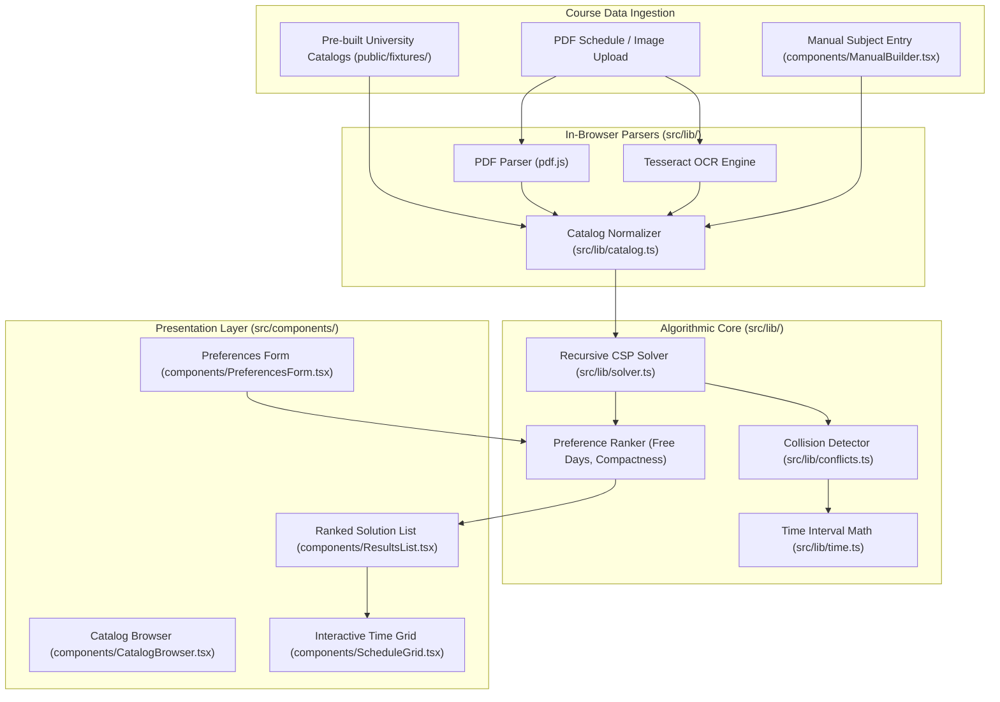
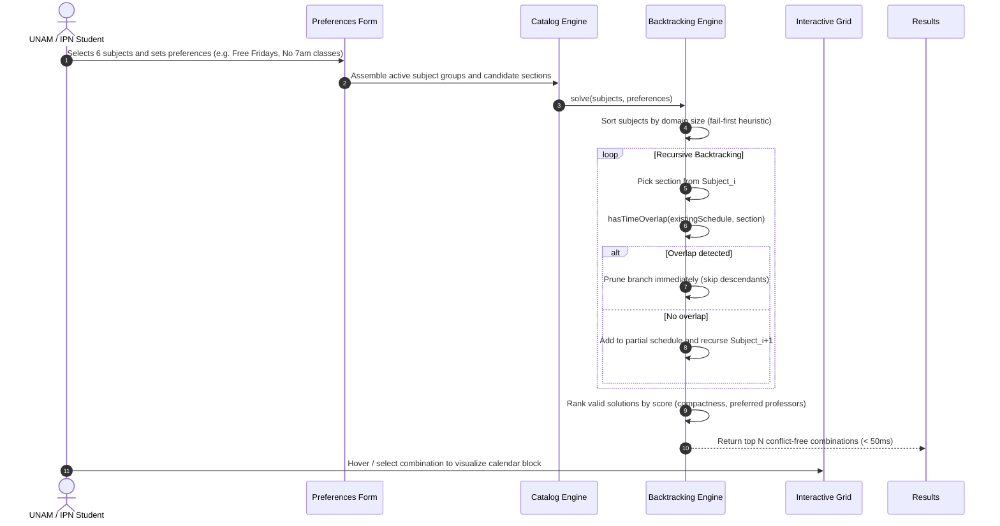

# 🏛️ UniSched Optimizer Architecture & System Topology

Algorithmic course schedule optimizer and constraint satisfaction solver for Mexican university students (UNAM FES Cuautitlán, FI, FES Aragón, IPN ESCOM, UPIICSA, UAM). Built with Next.js 15, TypeScript, React, and in-browser PDF/OCR parsing. Employs recursive backtracking to generate conflict-free academic schedules in sub-second time.

---

## 1. Technology Stack

| Layer | Technology | Details |
| :--- | :--- | :--- |
| **Framework** | Next.js 15 & React 19 | Client-rendered privacy-first web application (zero server latency) |
| **Language** | TypeScript 5 (Strict Mode) | Full type safety for course sections, schedules, and conflict matrices |
| **Algorithmic Engine** | Backtracking & CSP Solver | Constraint satisfaction problem (CSP) pruning branch collisions early |
| **Parsing Engine** | `pdf.js` & `tesseract.js` | Client-side PDF catalog extraction and OCR for photo schedules |
| **Styling** | CSS Modules & Modern CSS | Responsive time-grid layout with collision color coding |
| **Testing** | Node.js / Jest / Vitest | Unit tests for collision detection, time intervals, and solver pruning |

---

## 2. System Topology & Component Graph



---

## 3. Constraint Satisfaction (CSP) Solving Lifecycle



---

## 4. Directory Structure & Module Breakdown

```
unisched-optimizer/
├── src/
│   ├── app/                  # Next.js App Router entrypoints
│   │   ├── layout.tsx        # HTML shell and metadata
│   │   ├── globals.css       # Design tokens and base styling
│   │   └── page.tsx          # Main single-page application dashboard
│   ├── components/           # UI components
│   │   ├── CatalogBrowser.tsx# University catalog selector (UNAM, IPN, UAM)
│   │   ├── PreferencesForm.tsx# Student constraint sliders (gaps, hours, days)
│   │   ├── ScheduleGrid.tsx  # Interactive weekly calendar (Monday-Saturday)
│   │   ├── ResultsList.tsx   # Ranked viable schedule cards with metrics
│   │   ├── ManualBuilder.tsx # Custom course and section creation panel
│   │   └── UploadPanel.tsx   # Drag-and-drop PDF/image schedule parser
│   └── lib/                  # Pure TypeScript domain & algorithmic logic
│       ├── solver.ts         # Recursive backtracking CSP solver with heuristic pruning
│       ├── conflicts.ts      # Pairwise and interval schedule clash detectors
│       ├── time.ts           # Minute-based time math, conversions, and formats
│       ├── catalog.ts        # Course and group schema validators
│       ├── types.ts          # Core interfaces (Section, Subject, Schedule, Preference)
│       └── *.test.ts         # Unit tests verifying collision math and solver logic
├── public/fixtures/          # Preloaded official university schedules (JSON)
│   ├── fes-cuautitlan-*.json # UNAM FES Cuautitlán (Informatica, Industrial)
│   ├── ipn-*.json            # IPN (ESCOM Sistemas, UPIICSA Informática)
│   └── unam-*.json           # UNAM (Facultad de Ingeniería, FES Aragón MAC)
├── scripts/scraper/          # Web and catalog scrapers for university schedules
├── package.json              # Project dependencies and build scripts
└── tsconfig.json             # TypeScript compiler settings
```
